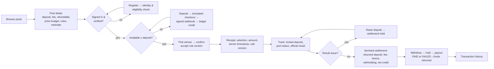
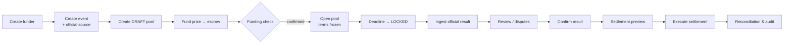
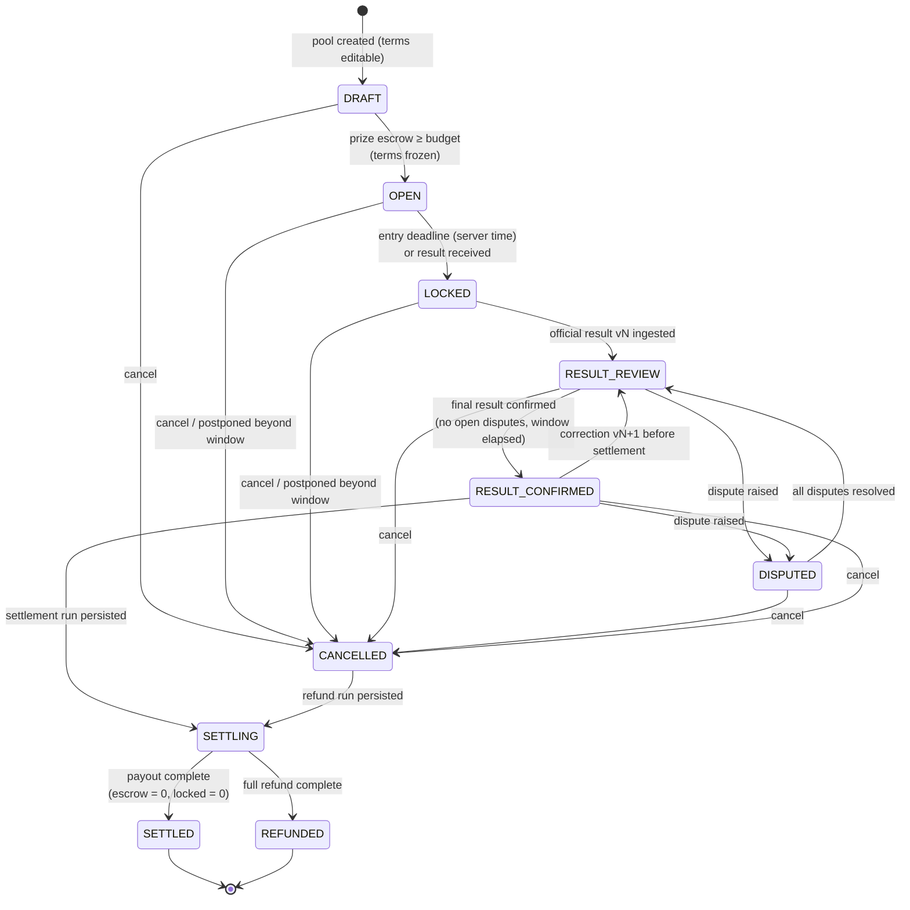
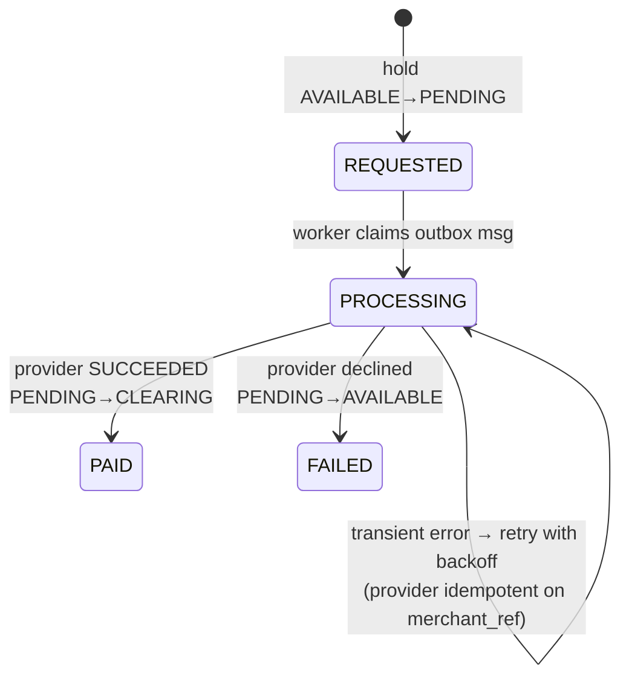

# 3 · User journeys and pool lifecycle

## Participant journey

### Journey detail
| Step | User sees | System guarantees |
|---|---|---|
| Browse | Open, closed and settled pools with headline money terms | DRAFT pools are hidden |
| Detail | Exact fee and refundable amount; confirmed prize budget and its source; per-selection bonus **estimate** with maximum; a "you can lose the fee" notice; rules; terms hash; server-time countdown | Terms are frozen and hashed |
| Eligibility | Verification form; deposit limit; self-exclusion | PII is encrypted; checks run on every deposit and entry |
| Fund | Simulated checkout and the credited balance | Credit happens only after a verified, de-duplicated callback |
| Enter | Confirmation dialog that restates the fee loss; checkbox accepting the rule version | Locked transaction; server-clock deadline; one entry per account; idempotency key |
| Receipt | Receipt id, selection, amounts, timestamp, rule version, hash, ledger txn | Stored and retrievable at any time |
| Track | Entry status, locked balance, official winner | — |
| Settlement | Itemised statement | Every credit is backed by one balanced ledger transaction |
| Withdraw | Request status and history | Separate from settlement; failures are reversed |

## Operations journey

## Pool lifecycle state diagram

Notes:
- A tie, no result, or no correct predictions goes `RESULT_CONFIRMED → SETTLING → REFUNDED`.
- Every transition is a compare-and-set update (`UPDATE … WHERE status = ANY(expected)`). Each one writes an append-only `pool_status_history` row and an audit record.
- `SETTLING` can be resumed. A crashed run is retried and skips lines that were already posted.

## Withdrawal lifecycle

