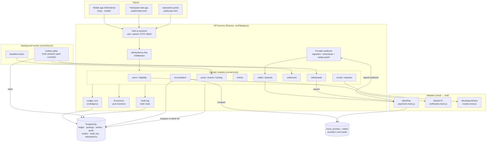

# 4 · System architecture

## Design decisions
| Concern | Approach |
|---|---|
| Modularity | One module per domain. Modules talk to each other only through service functions and the outbox. Each adapter has a narrow interface (`createCheckout`, `payout`, `verifyIdentity`, `fetchResult`), so a real vendor can replace the mock without changes to the domain code. |
| Money representation | `BIGINT` minor units everywhere. A JS guard rejects values that are not safe integers. Percentages are basis points, and rounding uses BigInt. |
| Ledger | Append-only `ledger_transactions` and `postings`. Balances are always `SUM(postings)`, through the `account_balances` view, and are never stored or edited. Deferred constraint triggers enforce zero-sum per currency and no overdraft at commit. Update, delete and truncate are blocked by triggers. |
| Account separation | `USER_AVAILABLE`, `USER_LOCKED` (per user per pool), `USER_PENDING_WITHDRAWAL`, `SPONSOR_AVAILABLE`, `POOL_PRIZE_ESCROW` (per pool), `FEE_REVENUE`, `WITHHOLDING_PAYABLE`, `PROVIDER_CLEARING`. |
| Concurrency | Entries lock the pool row, then the user row, then the account rows (in id order), all `FOR UPDATE`. The deadline is checked with `clock_timestamp()` *after* the locks are held. `UNIQUE(pool_id,user_id)` is the final backstop. Withdrawals lock the user's accounts. Deadlocks and serialisation failures are retried. |
| Idempotency | API: an `Idempotency-Key` on deposits, entries and withdrawals; the response is stored and replayed, and a key reused with a different body gets 422. Ledger: a unique `idempotency_key` per business effect (`deposit:<providerPaymentId>`, `entry-lock:<pool>:<user>`, `settle:<entry>`, `withdrawal-paid:<id>`…), and reuse with different content is refused. Webhooks: `UNIQUE(provider, provider_event_id)`. Outbox: unique `dedupe_key`. |
| Provider callbacks | HMAC-SHA256 over `timestamp.body`, a constant-time comparison, a ±300 s tolerance window, event-id replay guard, and amount/currency/reference match against the intent. A mismatch is flagged, never credited. |
| Transactional outbox | Messages are inserted in the same transaction as the state change. Workers claim them with `FOR UPDATE SKIP LOCKED` and a 30 s lease, back off exponentially, and mark a message DEAD after 8 attempts. Handlers are idempotent. |
| Settlement | The plan is persisted once (`settlement_runs`, `settlement_lines`) and never recomputed. Each line posts one keyed ledger transaction. A final step sweeps the remainder and asserts that escrow and locked balances are 0. Crashes resume, and concurrent runs cannot double-pay. |
| Withdrawals | A separate flow. Hold → provider payout outside the DB transaction → finalise. The provider is idempotent on `merchant_ref = withdrawal id`, so a lost response is retried safely. |
| Reconciliation | Ledger invariants, plus a comparison of internal deposit/withdrawal records with the provider's books, plus clearing position = provider net. |
| Security | scrypt password hashing; sessions stored as SHA-256 hashes of random tokens; admin TOTP MFA (RFC 6238) required; RBAC per endpoint; AES-256-GCM for identity fields, with only the last 4 digits in clear and every reveal audited with a reason. |
| Audit | `audit_log` is hash-chained (each row hashes the previous one) and written in the same transaction as the action. Immutability is enforced in the database. The chain is verified in reconciliation. |
| Mobile client | Expo/React Native app over the same REST API. Bearer token kept in Keychain/Keystore. A fresh idempotency key per confirmation. The API has an allow-listed CORS policy for the web build. |
| Live payments | `config.payments.mode = 'SIMULATED'`. `assertLivePaymentsAllowed()` always throws until jurisdiction, provider approval, custody and tax rules are supplied. |

## Production hardening (beyond the MVP)
- Run the API and worker as separate deployments (`npm start`, `npm run worker`) with a managed Postgres instance and PITR backups.
- Keep secrets (webhook secret, PII key) in a KMS. Rotate the PII key using `key_version`.
- Rate limiting and WAF; CSRF protection if sessions move to cookies; content security policy.
- Separate read replica for the operations dashboards. Partition `postings` by month.
- Four-eyes approval for result confirmation and settlement execution. The hook point is `results.confirmResult` and `settlement.requestSettlement`.
