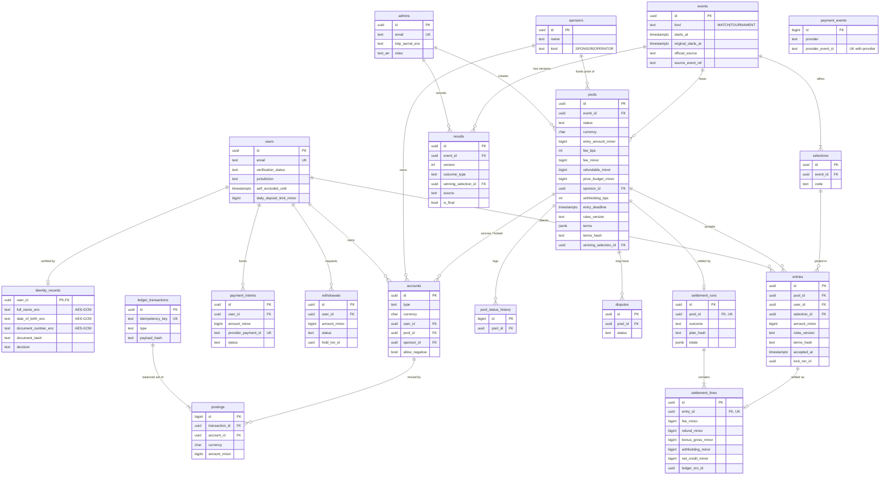

# 5 · Entity-relationship diagram and migrations

The migration is in [`db/migrations/001_init.sql`](../db/migrations/001_init.sql). `src/db.js#migrate()` applies it and records it in `schema_migrations`.

Supporting tables not drawn above: `sessions`, `idempotency_keys`, `outbox`, `audit_log` (hash-chained), and `mock_provider_transactions` / `mock_provider_settings` (the simulated provider's own books).

## Constraints that carry business rules
| Rule | Enforcement |
|---|---|
| One entry per account per pool | `UNIQUE (entries.pool_id, entries.user_id)` |
| Entry selection belongs to the pool's event | composite FK `(selection_id, event_id) → selections(id, event_id)` |
| Fee + refundable = deposit | `CHECK` on `pools` and `settlement_lines` |
| Net = refund + bonus − withholding | `CHECK` on `settlement_lines` |
| Terms frozen after DRAFT | `pools_freeze_terms` trigger |
| Balanced transactions | deferred constraint trigger `ledger_txn_balanced` |
| No overdraft (except clearing) | deferred constraint trigger `ledger_no_overdraft` |
| Immutable history | `forbid_mutation` triggers on ledger, postings, audit, payment events, results, status history (update, delete, truncate) |
| Settlement line written once | `settlement_lines_guard` |
| One settlement per pool | `UNIQUE settlement_runs.pool_id` |
| Callback replay | `UNIQUE (payment_events.provider, provider_event_id)` |
| Results only as a winner when a winner exists | `CHECK ((outcome_type='WINNER') = (winning_selection_id IS NOT NULL))` |
